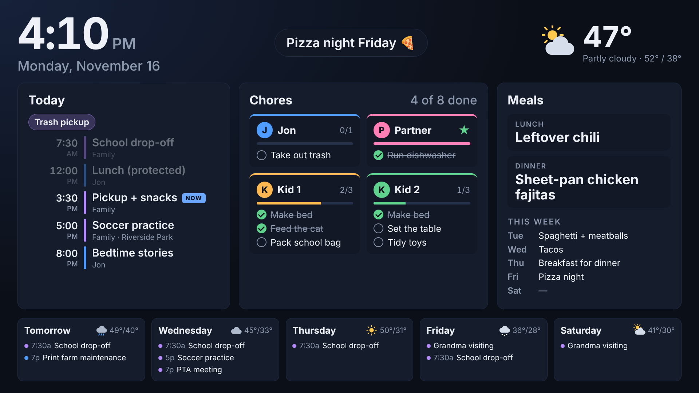

# Mission Control

A homemade family dashboard for the living room TV: today's schedule, everyone's chores, lunch and dinner, the weather, and the week ahead. You manage it from your phone.

- **TV display:** `http://<server>:3000/`. Read-only and built for viewing from the couch. Updates itself.
- **Phone admin:** `http://<server>:3000/admin`. Tick off chores, plan meals, edit chores, people, calendars and settings.



No accounts, no cloud and no subscription. Everything lives in `data/db.json` on the machine that runs it.

## What it does (v0.1)

| Area | How it works |
|---|---|
| Calendars | Reads iCloud, Google or Outlook calendars from their share links (iCloud: turn on **Public Calendar** and paste the `webcal://` link). Recurring events, all-day events and multi-day events all work. Each calendar can belong to a person and use their color. |
| Chores | Each chore has an owner and the days it repeats. Tick them off on a phone, and the TV updates within about 15 seconds. History is kept for a year, ready for points or rewards later. |
| Meals | Lunch and dinner for each day. The TV shows today in large text and the rest of the week's dinners below. |
| Weather | [Open-Meteo](https://open-meteo.com/). Free, with no API key. Set the city in Admin → Settings. |
| Night mode | Between two times you choose, the TV shows only a dim clock. |
| Self-healing | The TV reloads itself when the server restarts, after an update, and once a night at 3:30. |

## Run it

You need [Node.js](https://nodejs.org/) 20 or newer.

```bash
npm install
npm start
```

Open `http://localhost:3000` for the TV view and `/admin` for the admin page. The first run creates `data/db.json` with placeholder people and chores, which you rename or delete in Admin.

To use the admin page on your phone, open `http://<computer's-local-IP>:3000/admin` while on home Wi-Fi, then use "Add to Home Screen" so it works like an app.

## Getting it onto the TV

The server has to run on something that's always on. The TV just shows a web page. The cheapest options, best first:

1. **An old laptop or PC plugged into the TV by HDMI.** It runs the server and shows the page, so you only need one box and it costs nothing if you already have the hardware. Open Chrome full screen in kiosk mode:
   `chrome --kiosk --noerrdialogs --disable-infobars http://localhost:3000`
2. **A Raspberry Pi** (about $45–80) behind the TV. Same setup as option 1, but small, quiet and low-power. It's a good later upgrade, and you can 3D print a case for it.
3. **The TV's own browser or a Fire TV / Google TV browser app**, pointed at the server running on another always-on computer. It works, but TV browsers tend to sleep, zoom oddly or close the page. Treat this as the fallback.

Disable sleep and screensaver on whatever drives the TV. Night mode handles the dim hours.

### Start automatically on Linux / Raspberry Pi (systemd)

```ini
# /etc/systemd/system/mission-control.service
[Unit]
Description=Mission Control family dashboard
After=network-online.target

[Service]
WorkingDirectory=/home/pi/Mission-Control
ExecStart=/usr/bin/node server.js
Restart=always
User=pi

[Install]
WantedBy=multi-user.target
```

Then run `sudo systemctl enable --now mission-control`.

On Windows, use Task Scheduler to run `npm start` in this folder at logon, and add the Chrome kiosk shortcut to the Startup folder.

## Configuration

Everything is set in **Admin**, so you shouldn't need to edit files. A few environment variables are available:

| Variable | Default | |
|---|---|---|
| `PORT` | `3000` | |
| `DATA_DIR` | `./data` | Where `db.json` lives. **Back this folder up.** |

## Privacy and security

- Calendar iCal links are secret: anyone who has one can read that calendar. They're stored only in `data/db.json`, which is git-ignored.
- The admin page has **no login**. It's meant for your home network only. Don't port-forward it to the internet.

## Customizing the look

The TV theme uses CSS variables at the top of `public/display.css` (colors, corner radius). Every size is in `rem`, and `1rem` scales with the screen, so the layout looks the same on a 720p or 4K TV.

## Project layout

```
server.js            API, calendar fetching, weather, and JSON storage
public/index.html    TV display      (display.css, display.js)
public/admin.html    phone admin     (admin.css, admin.js)
public/shared.js     helpers and weather icons
data/db.json         your household data (created on first run, git-ignored)
```

## Ideas for later

- Star or point rewards for chores, with a weekly tally
- A shared grocery list that meals add to
- A recipe link or photo for each meal
- A photo slideshow during night mode
- A one-off "today only" chore or reminder
- A printed TV-mounted case for a Pi, plus a cheap touchscreen in the kitchen showing the same page
